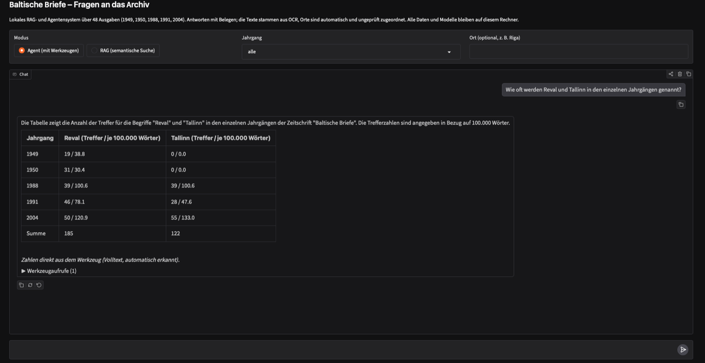

# bb-rag – Fragen an die „Baltischen Briefe“

[](https://github.com/ab1601/bb-rag/actions/workflows/ci.yml)

Lokales **RAG- und Agentensystem** über die Zeitschrift *Baltische Briefe* (deutschbaltische Diaspora):
48 Ausgaben aus den Jahrgängen 1949, 1950, 1988, 1991 und 2004, rund 290.000 Wörter, OCR-Text mit
automatisch erkannten Orts- und Personennamen.

Alles läuft **lokal**: Embeddings, Vektordatenbank und Sprachmodell. Die Texte verlassen den Rechner nicht.



## Was es kann

| Modus | Ablauf | Gut für |
|---|---|---|
| **RAG** | Frage → semantische Suche (Chroma) → Llama 3.1 antwortet nur aus den gefundenen Abschnitten, mit Belegen [1], [2] … | inhaltliche Fragen |
| **Agent** | Llama 3.1 wählt selbst Werkzeuge, ruft sie auf und antwortet mit Belegen; laufende Werkzeugaufrufe und der Antworttext erscheinen live; Rückfragen („Und bei Dorpat?“) beziehen das Gespräch ein | Zählen, Vergleichen, Register, kombinierte Fragen |

Werkzeuge des Agenten (`bb_rag/agent.py`, `bb_rag/tools.py`):

- `semantic_search(query, year, place)` – Vektorsuche, optional nach Jahrgang oder Ort gefiltert
- `fulltext_search(term, year)` – exakte Wortsuche mit Treffern pro Jahrgang und Textstellen
- `place_register(name)` – alle Schreibformen eines Ortes mit Nennungen, Prüfstatus, Koordinate, Wikidata
- `compare_years(terms)` – Häufigkeit eines oder mehrerer Wörter je Jahrgang als Tabelle, absolut und je 100.000 Wörter

Beispiel: *„Wie oft werden Reval und Tallinn in den einzelnen Jahrgängen genannt?“* → der Agent ruft
`compare_years("Reval, Tallinn")` auf und antwortet mit einer Tabelle exakter Zahlen statt mit Schätzungen.

### Zahlen kommen aus dem Code, nicht aus dem Sprachmodell

Beim Testen zeigte sich, dass ein 8B-Modell korrekte Werkzeugergebnisse falsch zusammenfasst – etwa „Tallinn
wird nur 1988 und 1991 erwähnt“, obwohl die Tabelle auch 2004 enthielt – oder nach einem Werkzeugfehler Zahlen
erfindet. Deshalb:

- Werkzeuge liefern Zahlen als fertige Tabellen mit einer **berechneten Kurzfassung** (Summen, Jahrgänge,
  Gleichstand); der Code hängt beides unverändert an die Antwort (`attach_tables`).
- Sätze des Modells, die Vergleiche oder nicht belegte Zahlen zu den verglichenen Wörtern enthalten
  („Tartu wird häufiger genannt“), werden entfernt; Zahlen, die wörtlich in anderen Werkzeugergebnissen
  stehen, bleiben erhalten.
- Fehlerhafte Argumente des Modells (z. B. Jahrgang `"None"`) werden abgefangen und als klare Meldung zurückgegeben.
- Der Prompt verbietet Zahlen, die in keinem Werkzeugergebnis stehen; alle Aufrufe sind in der Oberfläche sichtbar.

## Schnittstelle (automatisierte Nutzung)

Die Chat-Oberfläche stellt automatisch eine API bereit (Gradio). Andere Programme können den Bot so ohne Browser
abfragen – zum Beispiel für Stapelverarbeitung oder Tests:

```python
from gradio_client import Client

bot = Client("http://127.0.0.1:7860/")
antwort = bot.predict(
    "Wie oft werden Reval und Tallinn in den einzelnen Jahrgängen genannt?",
    "Agent (mit Werkzeugen)",   # oder "RAG (semantische Suche)"
    "alle",                     # Jahrgang: alle, 1949, 1950, 1988, 1991, 2004
    "",                         # Ort (optional)
    api_name="/respond",
)
print(antwort)
```

Ohne Oberfläche, direkt in Python:

```python
from bb_rag.agent import ask, stream

result = ask("Welche Schreibformen gibt es für Tartu?")
print(result.text)                  # Antwort
for name, args, output in result.steps:
    print(name, args)               # aufgerufene Werkzeuge

# Live: Ereignisse tool_call → tool_result → delta (Text) → done
# async for event in stream("Und wie ist es bei Dorpat?", history=[...]): ...
```

## Evaluation: Modellvergleich

`eval/compare_models.py` stellt dem Agenten sechs feste Testfragen (Jahrgangsvergleich, Schreibformen,
Ortsregister, Inhaltsfrage, ungültiger Jahrgang, Rückfrage im Gespräch) und prüft Werkzeugwahl, Argumente,
erwartete Belege sowie bekannte Fehlaussagen im **rohen** Modelltext (vor den Schutzmechanismen):

```bash
BB_LLM_MODEL=llama3.1:8b .venv/bin/python -m eval.compare_models
BB_LLM_MODEL=qwen2.5:7b  .venv/bin/python -m eval.compare_models
```

| Modell (Ollama, Q4, Apple M5) | bestanden | Ø Antwortzeit | Beobachtungen beim Lesen der Rohtexte |
|---|---|---|---|
| Llama 3.1 8B (Standard) | 6/6 | 9 s | schnell; vereinzelt rohes Werkzeug-JSON im Text und erfundene Abschnittsnummern |
| Qwen 2.5 7B | 6/6 | 21 s | übernimmt Tabellen selbst, Aufrufe sauber; gut doppelt so langsam |

Entscheidung: Llama 3.1 8B bleibt Standard (Antwortzeit), die beobachteten Fehler fangen Schutzmechanismen ab:

- **Belegprüfung** (`check_citations`): Jede zitierte Abschnitts-ID muss in einem Werkzeugergebnis stehen;
  erfundene Nummern werden auf die belegte Ausgabe gekürzt (`bb_04_49#003` → `bb_04_49`) oder markiert.
- **JSON-Bereinigung** (`strip_tool_json`): rohe Werkzeugaufrufe im Antworttext werden entfernt.
- **Zahlen aus dem Code** (`attach_tables`, siehe oben).

Das Modell lässt sich ohne Codeänderung wechseln: `BB_LLM_MODEL=qwen2.5:7b`.

## Architektur

```
research-corpus.json ──► chunking.py ──► index.py ──► Chroma (storage/chroma)
 (Text + NER-Entitäten)   ~2.100 Abschnitte   Qwen3-Embedding-0.6B          │
                          mit Jahr, Ausgabe,  (Hugging Face, lokal)          ▼
                          Orten, Personen                     search.py ──► rag.py ──► Llama 3.1 8B (Ollama)
                                                                  │                         ▲
                                         tools.py ────────────► agent.py (LlamaIndex FunctionAgent)
                                                                  │
                                                               app.py (Gradio)
```

| Baustein | Technik |
|---|---|
| Framework | LlamaIndex (VectorStoreIndex, FunctionAgent, FunctionTool) |
| Embeddings | `Qwen/Qwen3-Embedding-0.6B` über Hugging Face / sentence-transformers (MPS oder CPU) |
| Vektordatenbank | Chroma, persistent, Kosinus-Ähnlichkeit |
| Sprachmodell | Llama 3.1 8B (Q4) über Ollama, Temperatur 0 |
| Oberfläche | Gradio |
| Tests / CI/CD / Evaluation | pytest, Modellvergleich (`eval/`), GitHub Actions mit Veröffentlichung in ghcr.io (Tests, Docker-Build, Prüfung der Kubernetes-Manifeste) |
| Betrieb | Docker, docker compose, Kubernetes mit Kustomize (Deployments, Services, PVCs, Jobs, Overlay) |

## Start (macOS, lokal)

```bash
python3 -m venv .venv && .venv/bin/pip install -r requirements-dev.txt
ollama pull llama3.1:8b                    # Ollama-App muss laufen
.venv/bin/python -m bb_rag.index           # Index bauen (~3 Min. auf Apple Silicon)
.venv/bin/python app.py                    # http://127.0.0.1:7860
.venv/bin/python -m bb_rag.agent "Welche Schreibformen gibt es für Tartu?"   # Agent im Terminal
```

Der Pfad zum Korpus wird über `BB_CORPUS` gesetzt (Standard: `../baltische-briefe-portal/data/research-corpus.json`).

## Docker

```bash
docker compose up -d
docker compose exec ollama ollama pull llama3.1:8b
docker compose run --rm app python -m bb_rag.index
# → http://127.0.0.1:7860
```

Korpus und Index werden als Volumes eingebunden, nicht ins Image kopiert.

**macOS:** Docker hat keinen Zugriff auf die Apple-GPU. Schneller ist es, die Ollama-App und das bereits
geladene Embedding-Modell des Mac zu nutzen – dafür gibt es eine eigene Compose-Datei (getestet mit
Docker Desktop 4.100 auf Apple Silicon):

```bash
docker compose -f docker-compose.yml -f docker-compose.mac.yml up -d --build app
# → http://127.0.0.1:7861
```

## Kubernetes

- `k8s/base/` – Namespace, PersistentVolumeClaims, ConfigMap, Deployments und Services für App und Ollama,
  Readiness- und Liveness-Probes; `jobs.yaml` lädt das Sprachmodell und baut den Index.
- `k8s/overlays/docker-desktop/` – Kustomize-Overlay für ein lokales Cluster auf dem Mac: nutzt Ollama-App,
  Embedding-Modell, Korpus und Index des Mac (Pfade im Overlay anpassen).

```bash
docker build -t bb-rag:latest .
kubectl apply -k k8s/overlays/docker-desktop          # lokal (Docker Desktop, getestet)
# oder: kubectl apply -k k8s/base && kubectl apply -f k8s/base/jobs.yaml   # alles im Cluster
kubectl -n bb-rag rollout status deploy/bb-rag
kubectl -n bb-rag port-forward svc/bb-rag 7862:7860   # → http://127.0.0.1:7862
kubectl delete namespace bb-rag                       # aufräumen
```

Getestet mit Docker Desktop 4.100 (Kubernetes 1.36, kubeadm) auf Apple Silicon. Die CI prüft alle Manifeste bei
jedem Push mit `kubeconform`.

## CI/CD

| Stufe | Job | Was passiert |
|---|---|---|
| CI | `test` | 23 Unit-Tests auf einem erfundenen Mini-Korpus (ohne Sprachmodell) |
| CI | `docker` | Image bauen, Smoke-Test im Container |
| CI | `kubernetes` | alle Manifeste mit `kubeconform` prüfen |
| CD | `publish` | nach grüner CI auf `main` bzw. bei Tags `v*`: Image für amd64 und arm64 in die GitHub Container Registry |

Veröffentlichte Images (nur Code, **keine Texte und kein Index** – die werden beim Start eingebunden):

```bash
docker pull ghcr.io/ab1601/bb-rag:latest      # neuester Stand von main
docker pull ghcr.io/ab1601/bb-rag:<commit>    # jede geprüfte Version, z. B. :sha-1189182
docker pull ghcr.io/ab1601/bb-rag:1.0.0       # Release (git tag v1.0.0 && git push --tags)
```

## Tests

```bash
.venv/bin/python -m pytest                 # 23 Tests, erfundenes Mini-Korpus, ohne Sprachmodell
.venv/bin/python -m pytest -m integration  # Ende-zu-Ende mit Ollama und echtem Index
```

Die Unit-Tests laufen auf `tests/fixtures/mini_corpus.json` – einem **erfundenen** Testkorpus. So laufen sie
auch in GitHub Actions, ohne dass Texte der Zeitschrift ins Repository gelangen.

## Daten und Rechte

Die Texte der *Baltischen Briefe* sind urheberrechtlich geschützt; die Rechte für eine Veröffentlichung sind
nicht geklärt. Deshalb enthält dieses Repository **keine Texte, keine Scans und keinen Index** (`storage/` und
`data/` stehen in `.gitignore`). Das System ist für die Forschung im nicht öffentlichen Rahmen gedacht.

## Grenzen

- OCR-Fehler und Silbentrennungen (*Liv- land*) stören Suche und Erkennung.
- Ortsnamen sind automatisch und **ungeprüft** zugeordnet; Schreibformen werden nur bei identischer
  Schreibweise zusammengeführt (*Dorpat*, *Tartu* und *Dorpat/Tartu* sind drei Einträge).
- Ein 8B-Modell wählt Werkzeuge meist sinnvoll, aber nicht immer; deshalb werden alle Aufrufe angezeigt.
- Volltextzählung (exakte Zeichenkette) und Registerzählung (NER-Nennungen) können voneinander abweichen.
